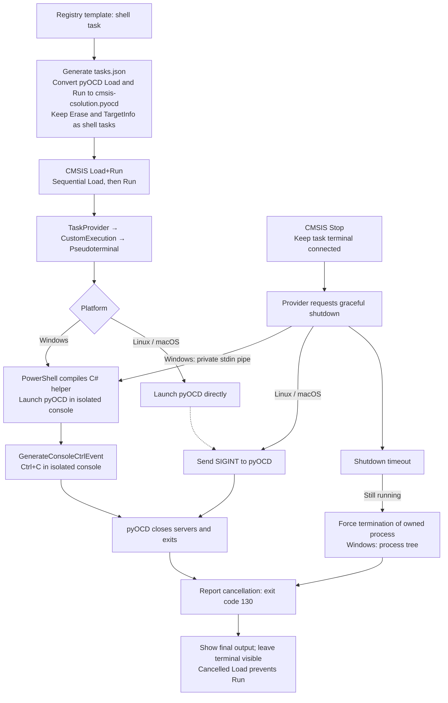

# CMSIS Solution Extension Architecture Documentation

> **Hint:** This documentation uses [Mermaid](https://mermaid.js.org/intro/syntax-reference.html) diagrams. For Visual Studio Code consider installing [Markdown Preview Mermaid Support](https://marketplace.visualstudio.com/items?itemName=bierner.markdown-mermaid).
> Manually crafted diagrams are created with [Draw.io](https://www.drawio.com/). For Visual Studio Code consider installing [Draw.io Integration](https://marketplace.visualstudio.com/items?itemName=hediet.vscode-drawio).

The overall architecture of a Visual Studio Code Extension is given in the following diagram:

A Visual Studio Code extension is split into two main parts: the extension host backend and the Chromium frontend. The extension host backend runs in a separate Node.js process and handles tasks such as file system access, language server communication, and other long-running operations. The Chromium frontend, which is part of the main VS Code window, is responsible for rendering the user interface and handling user interactions. This separation ensures that the UI remains responsive while the backend performs resource-intensive tasks.

Communication between the backend and frontend occurs via a JSON-RPC channel, which allows the frontend to send requests and receive responses. This channel only support structured data but no rich class objects to be transferred.

For testability reasons business logic shall be kept in the backend code as much as possible. Its easier to debug and unit test backend code than involving frontend code.

## Views

The extension contributes a couple of independent views to the Code UI.

### Solution Outline

The Solution Outline docks into the left panel presenting a tree view for the selected solution.

[TO BE DOCUMENTED](views/solution-outline)

### Create Solution

The Create Solution dialog shall present boards, devices, and draft projects to the user. The draft project shall be used to initialize a new solution workspace.

[TO BE DOCUMENTED](views/create-solutions)

### Configure Solution

[TO BE DOCUMENTED](views/manage-layers)

### Context Selection

[TO BE DOCUMENTED](views/manage-solution)

### Manage Components

[TO BE DOCUMENTED](views/manage-components-packs)

### Configuration Wizard

[TO BE DOCUMENTED](views/config-wizard)

## Business Logic

### Data Manager

The Data Manager abstracts access.

[Design Documentation](data-manager/DESIGN.md)

### Document Download

[`DocManager`](doc-manager/doc-manager.ts) orchestrates downloads for common Arm
PDFs and board/device web files from [`IDocRef`](doc-manager/docs-yaml-file.ts)
references. Each reference calculates its `downloadUrl` and destination through
`getDestinationPath()` without I/O or inventory mutation. The destination is
always a filename inside the reference's `indexDir`. The managed root is `docs`
beside the inventory file, normally `~/.cmsis/docs`.

- Common documents use `<root>/<id>-<version>/<id>-<version>[.<format>]`, preserving
  the requested version token. For example, `100230/latest` in PDF format uses
  `100230-latest/100230-latest.pdf`.
- Board and device downloads require `isWebDoc()` and an HTTP(S) URL. They use
  `<root>/<Vendor>/<Name>/<basename>/<FileName.ext>`, excluding hardware revision
  or processor suffixes and URL query parameters and fragments. Local user files
  use the same structure, deriving the basename and filename from the selected file.
- HTML-link imports use the URL basename for the index directory (`index` for a
  root URL) and the selected local filename. Common HTML-link imports retain the
  `<id>-<version>` layout with the selected file's extension. `getDestinationPath(localPath)`
  accepts the selected path, or reuses the stored path after import, without
  changing the reference's URL, format, or `H` classification.
- Missing or unsafe path components are rejected rather than rewritten.

For common PDF documents, the reference's `downloadUrl` constructs a metadata URL
under `https://documentation-service.arm.com/documentation/<id>/<version>`.
The manager calls [`DocDownload.downloadDoc`](doc-manager/doc-download.ts) with
`(doc.downloadUrl, destination, requirePdf, armDocId)`. The downloader resolves the metadata to
a PDF resource, preferring a filename matching the document ID. The resolved
resource URL is transient: the reference retains its canonical name and requested
version. Documents without a downloadable PDF are rejected.

The downloader owns a single two-minute timeout shared by metadata lookup and
file transfer. Requests follow at most five HTTP(S) redirects.
Downloads stream to a unique temporary sibling, reject empty responses, validate
the `%PDF-` header for common Arm PDFs, then rename to the final destination.
The downloader never receives or mutates a document reference. Successful
completion lets the manager set the reference's absolute `path` and clear its
`error`. The manager catches preparation and transfer errors, clears `path`, and
sets `error`. Failed transfers remove temporary files without deleting a previous
destination file.

Board and device web documents download directly from their HTTP(S) URLs, without
Arm metadata lookup or PDF-only restrictions. URLs are used without host-specific
rewriting, and the reference retains its original URL and title. Callers must supply
a direct file URL rather than a hosting service's HTML viewer URL. Local files and
HTML-only references cannot be downloaded.

The outline's Download Document command delegates to `DocManager.downloadDocument`.
Import is available for non-user `W` and `H` web references; Download is available
only for non-user `W` references. The outline uses `webDoc` for `W` and `webLink`
for `H`; Import accepts either feature and Download accepts only `webDoc`,
excluding user documents and local or pack files.

Add Document and Import share synchronous copying in `DocManager`, using
`fs-utils` where available. They validate the source and managed destination,
request Overwrite confirmation for an existing file, and copy directly to the
destination. Selecting the destination itself skips copying. Cancellation leaves
files and inventory unchanged. Copy failures are reported without assigning a new
path. A successful copy sets the absolute `path` and clears its error.
Import changes only the selected reference and retains its identity and metadata;
re-adding a same-filename user document reuses its entry within its hardware parent.
Inventory updates use `DocsYamlFile` and notify the outline after a successful save.

Remove Document deletes a selected user document's entire managed `indexDir`
before removing its inventory entry. The manager validates containment and rejects
symbolic-link directories. External legacy paths are retained.
A missing directory permits entry removal; deletion errors retain the entry and
are reported through the manager's error reporter.

Open Documentation checks the current inventory and
opens `path` only when the destination exists, otherwise falling back to `name`.
Web documents, including downloaded Markdown files, use this open command.

Manager tests cover request preparation, persisted success and failure state, and
records replaced or removed during a transfer. The downloader tests include an
offline invalid-URL regression, a mocked-fetch check of the shared timeout, and
real network downloads of `100230/latest` and the repository's GitHub `README.md`.
The live downloads use real temporary directories managed by `TestDataHandler`,
without mocks. File assertions use only filesystem
metadata to verify regular files larger than 100 bytes, without reading contents
or listing directories. Run them with
`npx jest --runInBand --runTestsByPath src/doc-manager/doc-download.test.ts --collectCoverage=false`.
They require network access to Arm's documentation service and GitHub's raw content
host.

### Solar Search Client

[TO BE DOCUMENTED](solar-search)

### Graceful Stop of pyOCD Load+Run Tasks

The extension manages the pyOCD processes used by CMSIS Load+Run so CMSIS Stop
can request graceful shutdown, wait for process exit, and retain the final
messages in the task terminal. Load+Run remains a compound task that executes
Load first and starts Run only after Load succeeds.

#### Task generation and execution

[`DebugLaunchProvider`](debug/debug-launch-provider.ts) renders the registry
adapter templates and converts only the pyOCD **CMSIS Load** and **CMSIS Run**
tasks from `"type": "shell"` to
`"type": "cmsis-csolution.pyocd"` before saving `.vscode/tasks.json`. Arguments,
working directory, and compound dependencies are retained. The registry
templates do not need to change: the conversion belongs to this extension.
The conversion requires both `"command": "pyocd"` and a task label of
`CMSIS Load` or `CMSIS Run`. Running the `pyocd` command alone does not qualify
a task for conversion.

**CMSIS Erase** and **CMSIS TargetInfo** retain `"type": "shell"` and do not use
managed pyOCD execution. Other pyOCD tasks also remain shell tasks, keeping the
change scoped to the Load+Run shutdown workflow. Regenerating
tasks also restores Erase and TargetInfo to shell execution if they were
previously generated with the managed type.

The conversion happens during task generation, before Load+Run executes.
Successful, non-detection solution conversion invokes the update command through
[`SolutionManager`](solutions/solution-manager.ts). Existing generated files can
also be refreshed with **Update Debug Tasks and Launch Configurations**
(`cmsis-csolution.updateDebugTasks`). Automatic updates to `tasks.json` and
`launch.json` require the **Auto Debug Launch** setting
(`cmsis-csolution.autoDebugLaunch`) to be enabled. When disabled, the update command
does not save changes to either file, preserving manual configuration.
Updating the task type does not
require a corresponding change to the launch configuration.

[`PyocdTaskProvider`](debug/pyocd-task-provider.ts) resolves configured tasks to
VS Code `CustomExecution` instances. Each execution creates a `PyocdTerminal`
implementing `Pseudoterminal`, which launches the process using the extension's
tools environment, forwards stdout/stderr, and reports completion. Active
terminals are tracked individually; Stop requests match task name and workspace
scope. Stopping Load+Run requests shutdown of its active Load or Run child.

#### Platform-specific shutdown

On Linux and macOS, the terminal launches pyOCD directly and sends SIGINT to its
child process when shutdown is requested.

On Windows, [`pyocdWindowsHost`](debug/pyocd-windows.ts) is an embedded PowerShell
script containing a C# helper. PowerShell's `Add-Type` compiles the C# code at
runtime when the task starts. The helper detaches from any inherited console,
allocates its own hidden Windows console, and launches pyOCD inside it. Its
redirected streams carry pyOCD output back to the pseudoterminal.

The extension sends `stop\n` through the helper's private stdin pipe. The helper
then calls `GenerateConsoleCtrlEvent(CTRL_C_EVENT, 0)`. This delivers Ctrl+C to
processes attached to that console, allowing Python's `KeyboardInterrupt` handling
to shut down pyOCD's servers and release resources. A console handler protects
the helper itself. Graceful delivery is scoped by the isolated console rather
than by a pyOCD process ID, so other consoles remain unaffected.

PowerShell/C# was selected because Node.js cannot directly invoke these Windows
console APIs, and Node's Windows SIGINT handling did not demonstrate graceful
pyOCD shutdown. C# accesses the APIs through P/Invoke, while Windows PowerShell
provides runtime compilation without an additional Python interpreter, native
Node addon, or separately built helper executable. The tradeoffs are startup and
compilation overhead and dependence on policies permitting PowerShell `Add-Type`.

#### Cancellation, output, and timeout handling

[`CmsisCommands`](tasks/commands/cmsis-commands.ts) routes CMSIS Stop through the
provider instead of immediately calling VS Code's task termination API for an
active managed task or its compound parent. The task terminal stays connected
until the child exits, receives the final output and result, and remains visible
because its presentation option `close` is set to `false`. Terminal Ctrl+C also
requests graceful shutdown. Explicit task termination or closing the terminal
can disconnect its UI early; the **CMSIS pyOCD** Output channel independently
retains the process output.

Cancellation reports exit code **130**, even if pyOCD handles the interrupt and
returns zero. A cancelled Load therefore fails its sequential dependency and
cannot advance to Run. Completion is reported once and removes the terminal from
tracking. Managed completion events supply exit codes to the existing UI
lifecycle handling because `CustomExecution` does not provide OS process events.

The Windows helper allows five seconds for graceful shutdown before using
`taskkill /PID ... /T /F` on the pyOCD process tree. The extension also has a
six-second fallback: it terminates the Windows helper's process tree, or sends
SIGKILL to the owned pyOCD process on Linux/macOS. Forced termination is reported
in the output so it can be distinguished from graceful shutdown.

